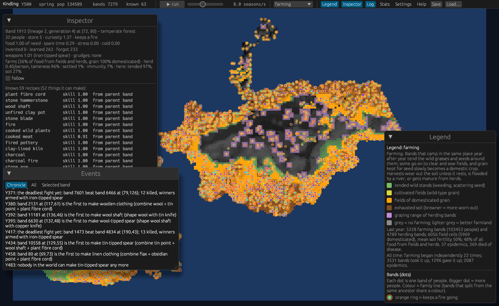

# Kindling

An emergent living-civilisation simulation in Rust, with a native viewer and a WebAssembly build.

No tech tree is written down anywhere: items, their properties and what can be made from them come out of a small material-physics model (hardness, fracture, sharpness, fuel temperature, refractoriness, ore reduction temperature…). Bands of foragers experiment with what is around them, keep what helps, teach neighbours and children, and forget what they stop using. Later versions add trade, conflict, disease and farming (domesticated plants emerge from wild progenitors).



## Layout
- `civ-core/`: the deterministic simulation (no graphics): rng, materials, physics (discovery rules), knowledge, map, params, bands, world, saves, analysis.
- `native/`: the `kindling` binary: macroquad + egui viewer and the headless runner. Builds for native and wasm.
- `web/`: the HTML/JS shell for the web build.
- `build-web.sh`: the WebAssembly build script.
- `docs/`: save format (`SAVE_FORMAT.md`), progress logs, raw multi-seed results, screenshots (`docs/images/`).

Prebuilt Linux, Windows and web builds are attached to the [GitHub Releases](https://github.com/Macrolol/kindling/releases).

## Building

Requires a recent stable Rust toolchain.

### Native viewer
```sh
cargo build --release -p kindling          # binary: target/release/kindling
cargo run --release -p kindling            # viewer, random seed
cargo run --release -p kindling -- --seed 7
```
Windows cross-build: `cargo build --release -p kindling --target x86_64-pc-windows-gnu`.

Viewer keys: Space pause, +/- speed, F follow, number keys switch overlays (terrain, know-how, item spread, population, deposits, temperature, trade, conflict, farming), Ctrl+S save, Ctrl+O load. Wheel zooms, drag pans, click selects a band. Settings can be changed live in the Settings window; each change is recorded in the world's settings log and saved with the world.

### Headless runner (multi-seed statistics, no window)
```sh
kindling --headless --seeds 1..10 --years 500 [--map WxH] [--threads N] [--config params.json]
```
- `--seeds A..B` runs each seed in the range (or `--seed S` for one).
- `--map WxH` sets the map size (default 256x160).
- `--threads N` sets sim worker threads (0 = all cores; `RAYON_NUM_THREADS` also works).
- `--config f` loads a params JSON file.
- `--progress-every K` prints a progress line to stdout every K years of each seed (default 50; 0 turns it off; `--report K` is the old name and still works). With `--json` the lines go to stderr so stdout stays JSON. Example:
  `  seed 3 Y 100 pop   3441 bands  141 items world  31 mean  19.4 max  26 fire  135 exp  257 inv   1 learn   92 forget  17 | 0.5s`
  (year; people; bands; items known anywhere, mean and max per band; bands with fire; experiments, inventions, learned and forgotten that year; wall time for the seed so far).
- Also: `--json`, `--verbose`, `--save out.civsave`, `--load file.civsave`, `--out DIR`.

Screenshot mode: `kindling --seed 1 --screenshot out.png --years 300 [--overlay 0-8]`.

Batch runs go through the `headless-sims` Actions workflow. Each run's outputs are archived on a public pre-release `run-<run id>` (`gh release download run-<id>`); see [docs/CI-ARCHIVES.md](docs/CI-ARCHIVES.md). Archives are public, so never include user saves.

### Web (WebAssembly)
```sh
rustup target add wasm32-unknown-unknown   # once
./build-web.sh
```
This runs `cargo build --release -p kindling --target wasm32-unknown-unknown`, then assembles `web-dist/` (the `.wasm`, the macroquad JS loaders from the cargo registry, and `web/index.html` + `web/civ_io.js`) and packages it as `web-dist.zip`. It needs `zip` installed. Serve `web-dist/` with any static file server, e.g. `python3 -m http.server -d web-dist`.

### Tests
```sh
cargo test --release
```

## License
MIT, see [LICENSE](LICENSE).
